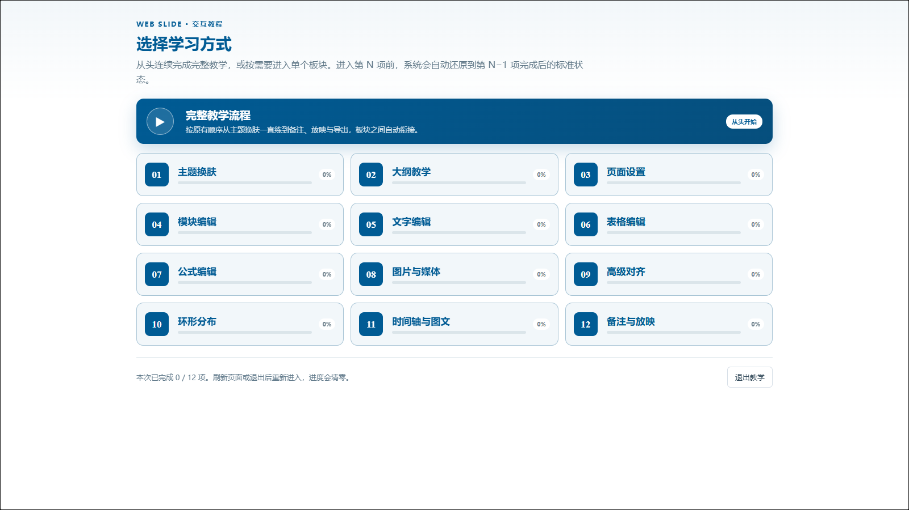

# 交互教程说明

交互教程在真实工作台中引导用户完成操作，而不是播放固定截图。

## 教学板块

主题换肤、大纲、页面设置、模块编辑、文字编辑、表格、公式、图片与媒体、高级对齐、环形分布、时间轴、备注与放映分别作为独立练习。

## 使用方式

- 可从头完成完整流程，也可从目录进入某个分项；
- 分项会自动打开对应练习页，不要求重复寻找页面；
- “代我完成此步”只执行当前操作；
- “代我完成本项”完成该分项剩余任务并保留结果；
- 结算后可关闭弹窗继续试用，也可返回教程目录；
- 进度只在当前打开期间保留，刷新或退出后重新开始。

教程只高亮当前需要操作的控件，完成一步后应清除旧高亮。教学卡片会根据目标控件位置自动避让，也允许手动拖动。

