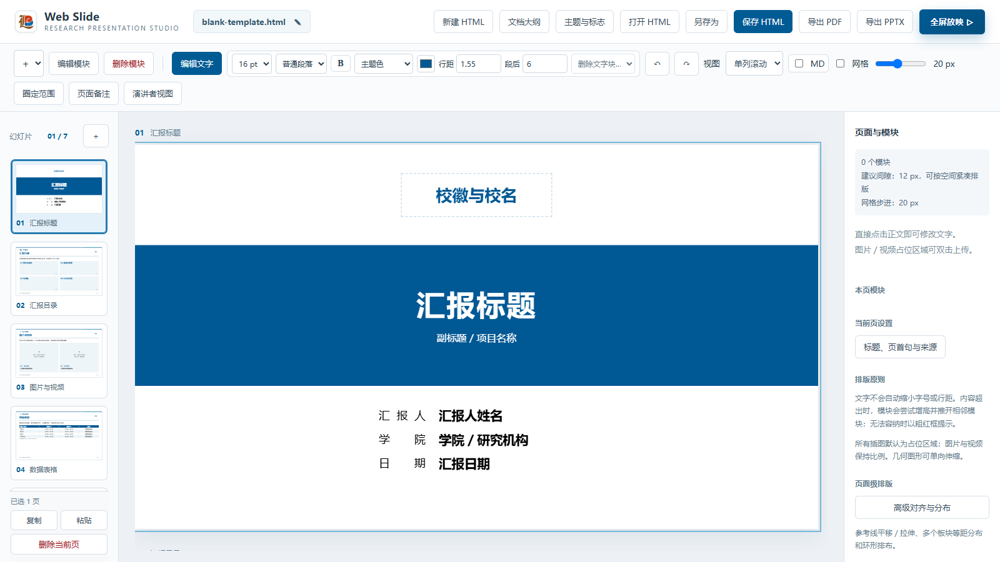

# 使用指南

Web Slide 的目标不是让 AI 一次性生成“看起来像 PPT”的页面，而是建立一条可以持续修改的工作流。

## 推荐流程

1. 收集真实材料，明确汇报目的、听众和时长。
2. 先确定总标题、章节关系和逐页标题。
3. 为每页准备核心结论、证据、图表和来源。
4. 由 AI 在既有模板与模块上生成初稿。
5. 用户在工作台中调整文字、表格、公式、媒体、尺寸和位置。
6. 补充页面备注，使用全屏或演讲者视图试讲。
7. 保存可继续编辑的 HTML，按需导出 PDF／PPTX。
8. 人工逐页审核事实、来源、字体、换行、遮挡与边界。

## 三种常见起点

- **从空白封面开始**：适合全新汇报，自行建立章节与页面。
- **从模块样例开始**：保留封面、目录、图片、表格、时间轴、公式和简历等页面骨架。
- **从学校主题模板开始**：复用身份、配色和版式，再替换真实内容与素材。

## 基本原则

- 先定内容，后定版式；不要用装饰掩盖材料不足。
- 一页只承担一个清晰任务，标题应直接表达页面结论或问题。
- AI 可以提炼与排版，但不得替代事实核验、来源确认和最终审美判断。
- 保存 HTML 后仍可继续交给 AI 或人工修改，不必每次重新制作。

