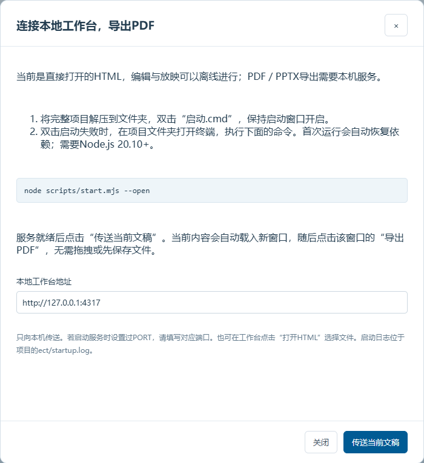
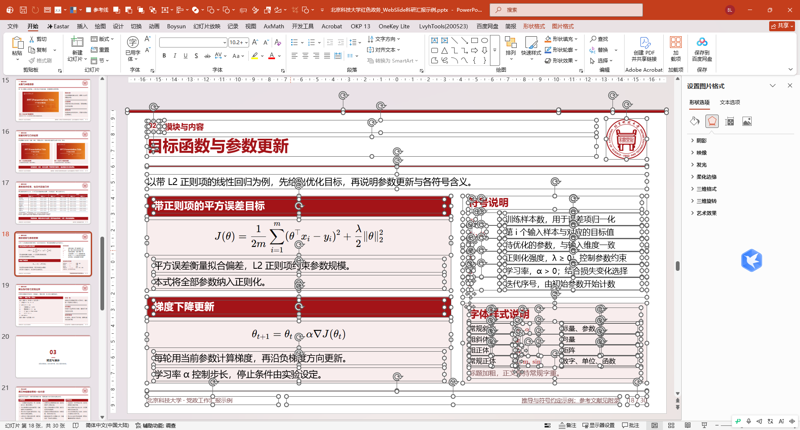
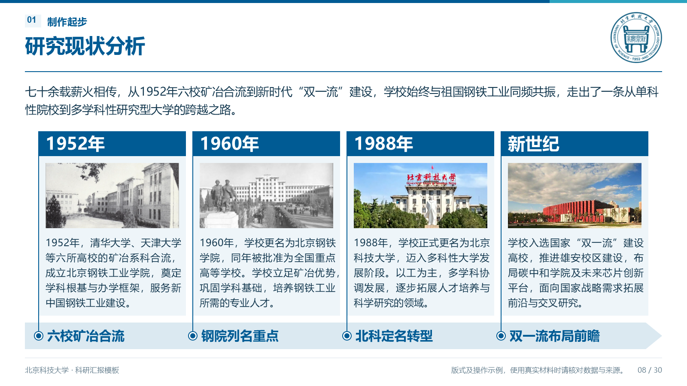

# 导出与排障

直接编辑和放映 HTML 可以离线进行；PDF／PPTX 导出需要本地服务。

## 首次使用

首次运行启动程序时，应检查 Node.js、Chrome／Edge 和项目依赖。若窗口报告缺少组件，不要盲目关闭 Windows 安全设置；应保留日志并根据错误信息处理。

## Windows 常见提醒

从网络下载的 ZIP 或脚本可能带有 Internet 来源标记，Windows 会提示“这些文件可能对你的计算机有害”。应先核对下载来源、文件签名与安全扫描结果，再决定是否解除阻止。不要因为想快速启动而全局降低系统安全级别。

## PDF 与 PPTX

- PDF 用于稳定呈现，应检查页面比例、裁切和字体嵌入；
- PPTX 用于继续编辑，应重点检查字体替代、颜色、标点断行、列表、页脚和公式；
- 导出路径应由用户明确指定，避免覆盖原稿；
- 正式交付前必须在实际 PowerPoint 环境逐页复核。

## PPTX 可编辑性示例

导出的页面由可选择的文字框、形状、图片和表格对象组成，不是整页截图。第一张 PowerPoint 实际截图显示公式页中的大量独立对象已被同时选中；第二张展示复杂时间轴页面导出后的完整效果，年份、图片、说明和阶段标题仍按页面结构分别生成。

