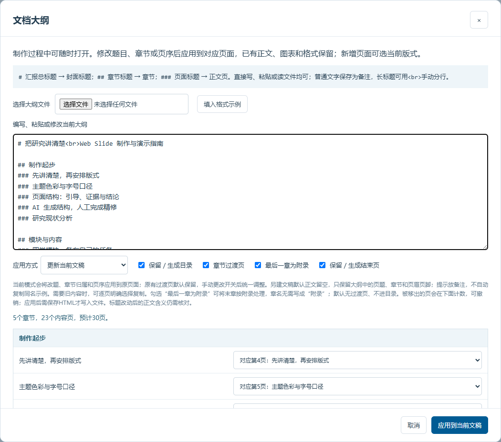
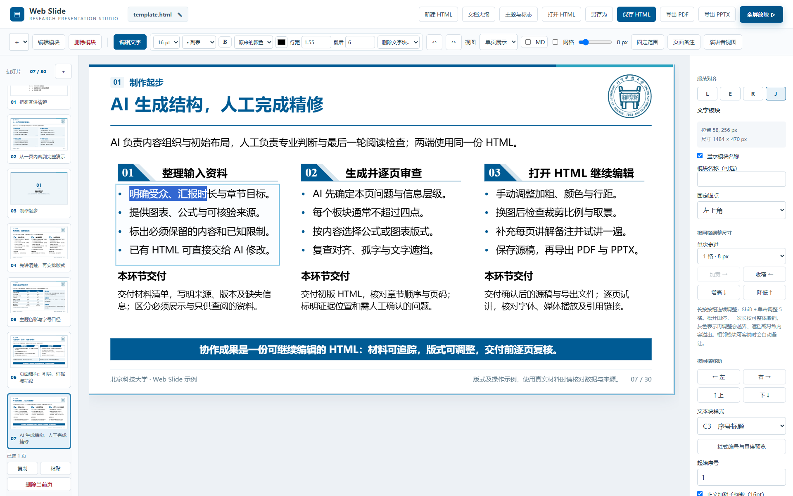
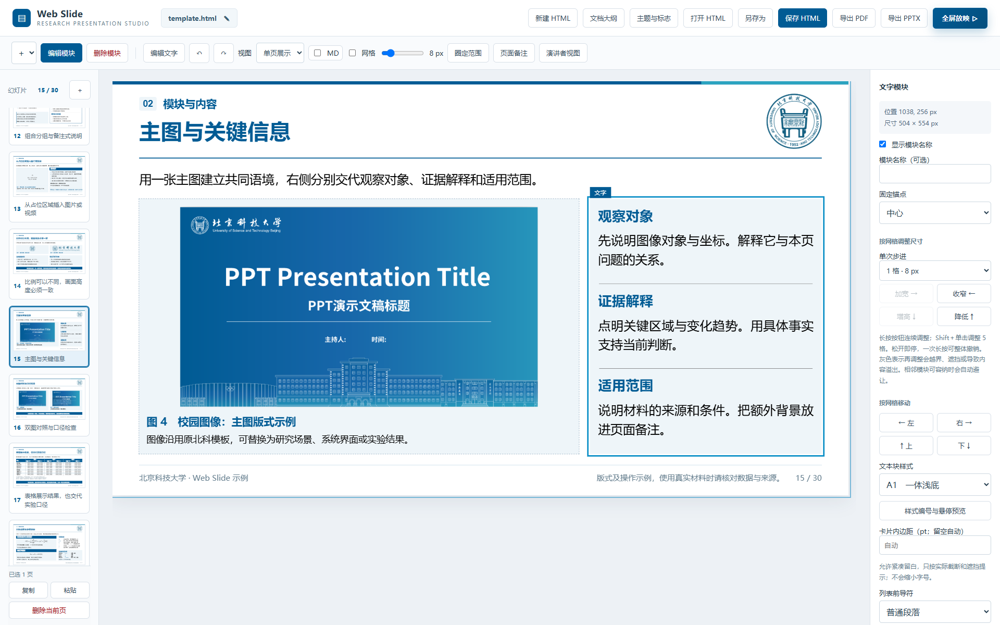

# 工作台控件说明

## 文档与页面

- 新建、打开、另存和保存 HTML；
- 导入或粘贴文档大纲；
- 页面复制、粘贴、拖动排序和删除；
- 单页、单列和多页视图切换；
- 页面标题、页首句、页尾总结、脚注、来源和备注设置。

## 文字编辑

- 对选中文字调整字号、粗细和颜色；
- 设置列表、左／中／右／两端对齐、行距和段后距；
- 支持多选文字块统一修改，也允许逐块细调；
- 模块外的独立文字块可以在正文安全区内移动。

## 模块与子区域

- 插入文字、表格、公式、媒体和时间轴模块；
- 增减、排序或删除子区域；
- 调整模块宽高、位置、固定顶点或固定中心；
- 选择 A／B／C 等文字块样式，并按内容决定是否显示模块标题。

## 表格、公式与媒体

- 表格可批量粘贴 Tab／回车数据，调整行列、字号与行高；
- 公式支持 LaTeX 编辑、预览和主题色／黑色切换；
- 图片与视频支持替换、裁剪比例、图注和并列等高；
- 时间轴可以隐藏年份、圆点、连线和箭头，转为普通并列图文卡片。

## 对齐与分布

- 显示网格时自动吸附，隐藏网格时自由移动；
- 纵向参考线控制左右位置，横向参考线控制上下位置；
- 支持单边平移、单边拉伸、多选等距和环形分布；
- 对齐应同时检查外框、标题基线、正文起点和底部边缘。

