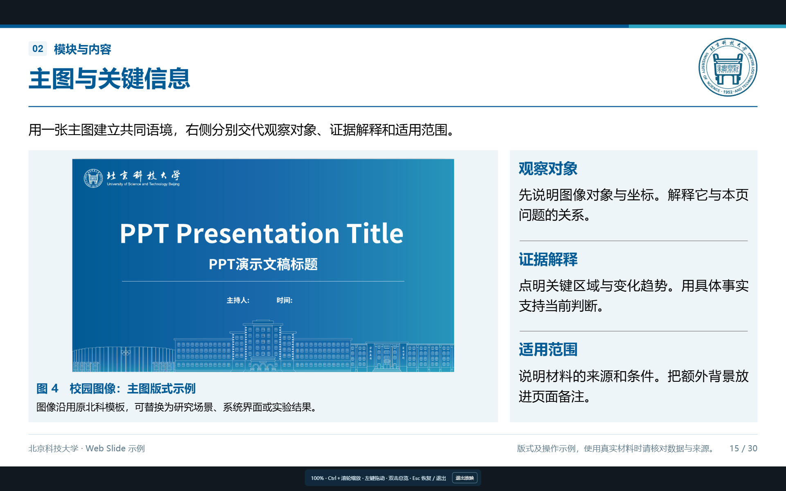
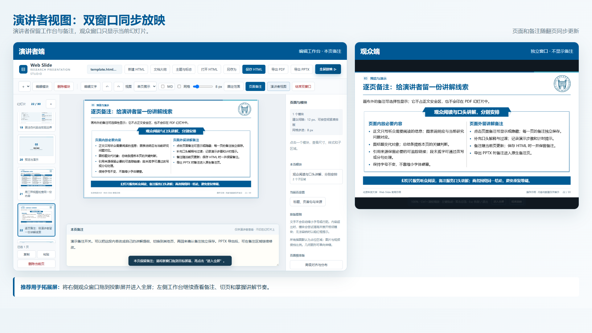

# 放映与备注

## 全屏放映

适合单屏演示。方向键、空格或滚轮翻页；双击进入多页总览，再双击指定页面返回。Ctrl＋滚轮缩放，放大后可用鼠标左键拖动；Esc 第一次恢复原始大小，再按一次退出全屏。

## 演讲者视图

适合投影仪或扩展屏。观众窗口只显示幻灯片，工作台窗口保留备注和编辑视角；两个窗口同步页码，由用户将观众窗口拖到目标屏幕。

## 页面备注

备注可记录讲解提示、引用来源、制作要求和待核对事项。单页或单列浏览时，备注应随当前页切换；多页浏览时，以用户明确点击选中的页面为准。备注不会进入观众画面。

