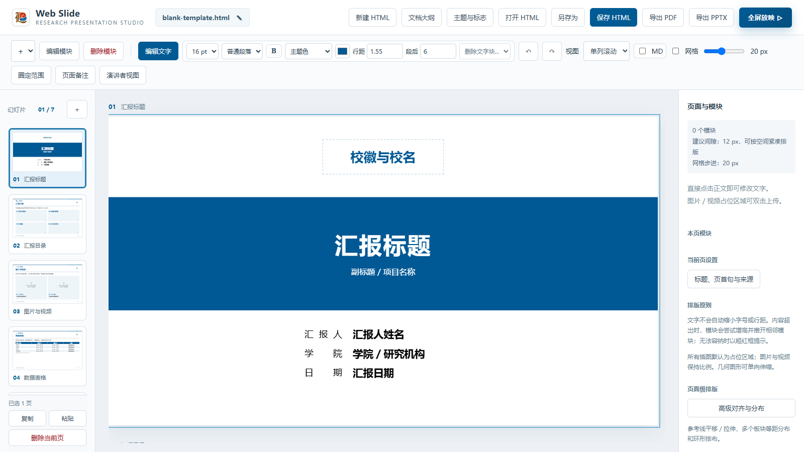
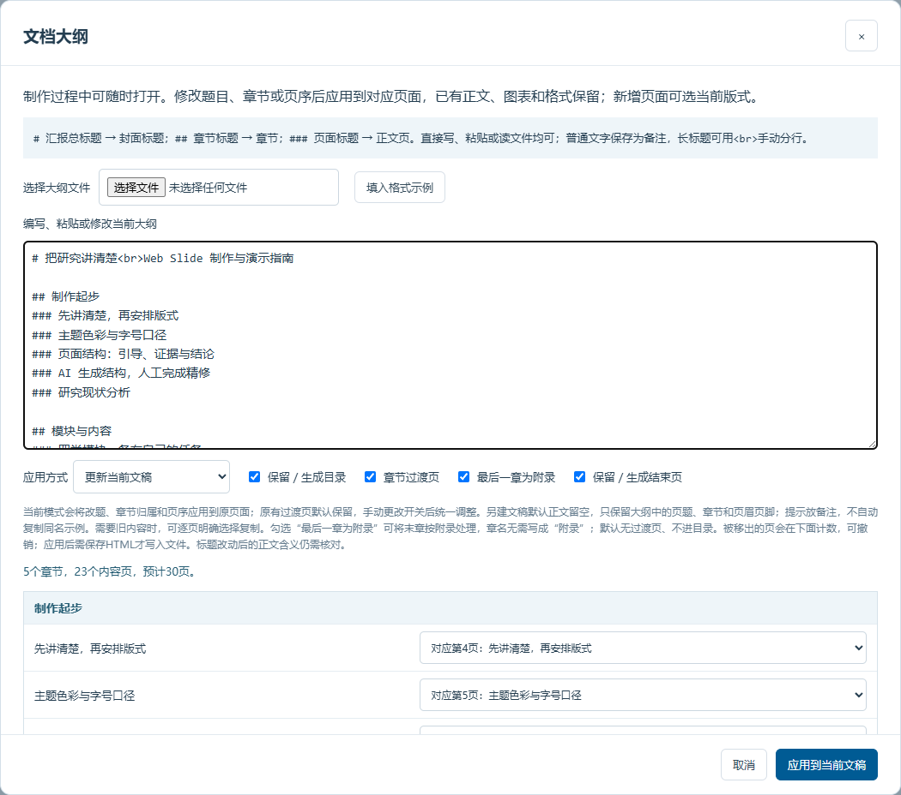
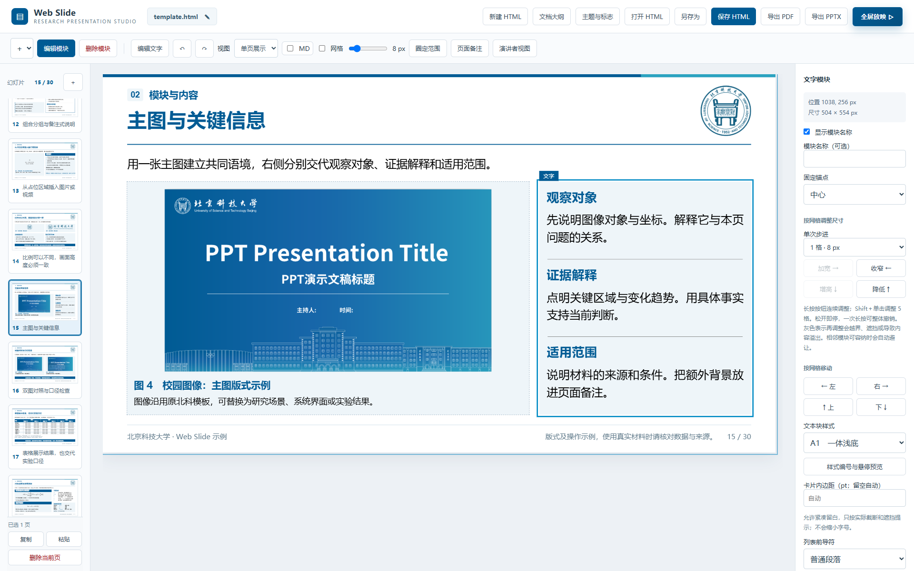
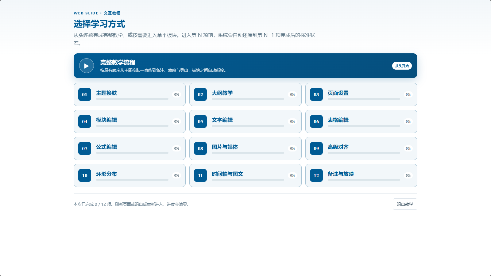
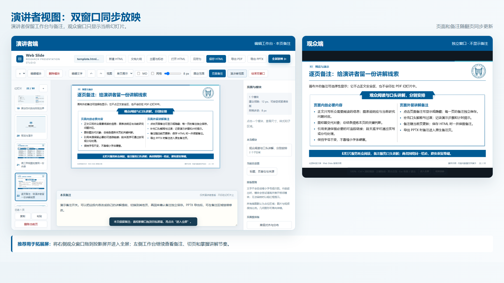

# Web Slide 工作台（公开介绍）

> **状态说明：** 本仓库原有的学校 HTML 模板已停止功能维护，仅作为历史示例保留。新一代 `html2ppt-web-slide` 工作台正在私有仓库中测试，尚未公开源码与安装包。

Web Slide 是面向科研组会、学术答辩和正式汇报的 HTML 幻灯片工作台。它把 AI 内容加工、浏览器人工精修、演讲备注以及 PDF／PPTX 交付组织在同一套流程中：先确定大纲和逐页结构，再使用模块化页面编辑文字、表格、公式、图片与版式，最后人工审核并导出。

下载或克隆本公开仓库后，可在本地打开 `html2ppt-web-slide/index.html` 查看完整网页介绍；GitHub 页面中请直接阅读本说明，避免进入 HTML 源代码视图。

## 当前能力概览

| 环节 | 主要能力 |
| --- | --- |
| 大纲与页面 | 粘贴或导入三级大纲，生成章节、目录、内容页与附录，并继续更新现有文稿 |
| 内容编辑 | 字符级文字格式、表格批量编辑、LaTeX 公式、图片／视频、时间轴与多子区域模块 |
| 排版调整 | 网格吸附、移动缩放、参考线平移与拉伸、多选等距和环形分布 |
| 放映与备注 | 单页／多页浏览、全屏放映、演讲者双窗口以及随页切换的备注 |
| 导出与迭代 | 保存可继续编辑的 HTML，并通过本地服务导出 PDF 和可编辑 PPTX |
| AI 协作 | AI 负责材料归纳、初稿与版式建议；用户负责事实核验、审美判断和最终审核 |

## 公开版与测试版

- `web-slide-ustb/`、`web-slide-lntu/` 是早期独立模板，仍可查看和下载，但不再继续增加工作台功能。
- 新版 `html2ppt-web-slide` 目前处于邀请测试阶段，代码仓库已设为 Private。
- 本目录只公开项目介绍、界面截图和阶段性能力说明，不包含私有测试版源码或发布包。

## 如何申请访问私有测试版

Private 仓库不能仅凭链接公开访问。测试者需要提供自己的 GitHub 用户名，由仓库所有者在 **Settings → Collaborators** 中发出邀请；接受邀请后，才可以查看、克隆和拉取仓库。

如需测试、合作或授权，请发送邮件至 [byliao@xs.ustb.edu.cn](mailto:byliao@xs.ustb.edu.cn)，并附上：

1. GitHub 用户名；
2. 使用场景与预期用途；
3. 是否需要模板定制或功能合作。

## 功能画面

### 大纲驱动的页面结构

### 模块化排版与人工精修

### 分项交互教学

### 演讲者双窗口

## 使用边界

新版仍处于测试期，界面、数据结构和导出机制可能调整。PPTX 虽已尽量保留可编辑文字、列表和页面结构，但不同 Office 环境仍可能出现字体替代、颜色或标点断行差异，正式交付前必须人工逐页审核。

