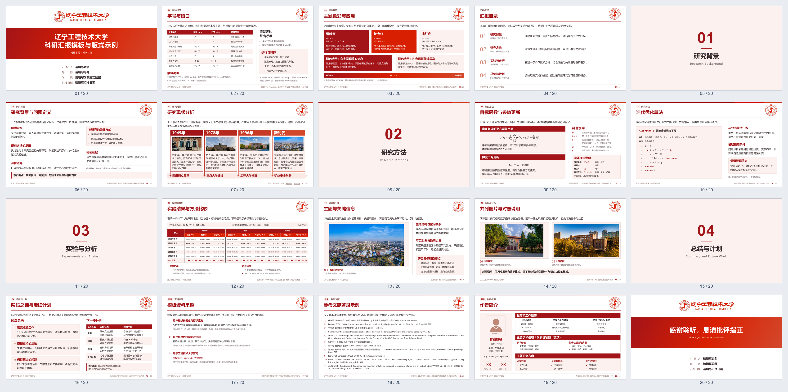

# 辽宁工程技术大学科研汇报 HTML 模板

一套可离线使用、可交给 AI 继续加工的科研汇报模板，适用于组会、研究进展、学术交流、答辩和入职汇报。学校全称为**辽宁工程技术大学（Liaoning Technical University）**。

本包在已有北科版的版式与交互基础上制作独立版本，替换为用户提供的辽工程校徽、红色系和校园风景。共20页、1600×900画布，包含四阶段研究现状、公式、伪代码、多级比较表、单图、双图、总结计划、参考文献及作者简介。**交付格式是 HTML 幻灯片与 PDF，不是原生 PPTX。**

## 20 页版式预览

按页码从左到右、从上到下排列（5 列 × 4 行）。点击预览图可查看原图；完整内容请打开 `template.html` 或 `template.pdf`。

[](preview.png)


## 1. 查看与编辑

1. 将ZIP完整解压，使用 Chrome 或 Edge 打开 `template.html`。
2. 工具栏可选择单列滚动、多页滚动（每行1–6页）或单页展示。
3. 点击“编辑文字”。选中文字后，可切换加粗，并选择“恢复原色／钢魂红／炉火红”。恢复原色按各处原有颜色恢复，不一律变成黑色。
4. 修改后点击“检查排版”，再查看改过的页面；检查换行、短尾行、图注、表格和来源。
5. 点击“保存HTML”，下载包含修改及内嵌图片的独立文件。**浏览器编辑不会自动写回磁盘原文件，关闭前务必保存。**

日常查看、文字编辑和保存不需要 Python、Office、Node.js 或网络。增加页面、更换图片、修改公式及大幅调整内容，适合交给能读写本地文件的 AI 或代码编辑器完成。

## 2. 全屏放映与缩放

点击“全屏放映”后隐藏编辑工具，整张16:9画布在屏幕内完整显示；屏幕比例不同时允许黑边。

| 操作 | 效果 |
|---|---|
| 方向键、空格、PageUp／PageDown | 翻页；Home／End到首页／末页 |
| 普通滚轮 | 向下下一页，向上上一页；连续滚动有限频 |
| Ctrl＋滚轮 | 以鼠标位置为中心缩放，100%–400%，不改变浏览器页面比例 |
| 放大后按住左键拖动 | 移动查看局部细节，拖动有边界限制 |
| 双击画面 | 进入固定四列的滚动预览，再双击指定页继续放映 |
| 第一次 Esc（放大时） | 恢复原始大小并清除平移，保留放映 |
| 原始大小时再按 Esc | 退出放映，恢复此前视图与每行页数 |

翻页、预览和退出时重置缩放；保存与打印不保留临时放大状态。浏览器拒绝原生全屏时降级为窗口放映。两级Esc依赖浏览器允许键盘锁；若未支持或未允许，第一次Esc可能先退出原生全屏，但仍恢复100%并保留窗口放映，下一次再退出。浏览器长按Esc强制退出原生全屏的通道仍保留。

## 3. 导出真正的16:9 PDF

需要 **Python 3.10+**（`python`命令可用）及本地 **Chrome 或 Edge**；不需要额外Python包或PDF打印机。当前完整流程在 Windows + Chrome 下验证。

- 双击 `导出PDF.cmd`：导出磁盘上的 `template.html`。
- 将另存的 HTML 拖到此文件上：导出该汇报，PDF存放在HTML同目录。
- 浏览器改过文字时，先“保存HTML”，再导出下载的文件。

也可在本包目录的终端中运行：

```powershell
python scripts/export-pdf.py
python scripts/export-pdf.py "我的汇报.html" --output "我的汇报.pdf"
```

导出页面本身为 **960×540pt（16:9）**，不把16:9内容缩放进A4，无浏览器添加的日期、路径和额外页码。工具会核对页数与页面尺寸。`template.pdf`是模板的静态预览，HTML内容改变后需重新导出。

## 4. 安装为 Codex skill

### Windows一键安装

解压后双击 **`安装Skill.cmd`**。它使用系统PowerShell，将完整模板复制到：

```text
%USERPROFILE%\.codex\skills\lntu-ppt-template\
```

若设置了 `CODEX_HOME`，则安装到其 `skills\lntu-ppt-template` 下。安装不需要Python，不修改原模板，也不覆盖其他学校的skill。**目标目录已存在时会停止，避免覆盖既有修改。** 后续更新可先把旧安装目录改名备份，再运行安装程序。

### 手动安装

将整个包复制为 `~/.codex/skills/lntu-ppt-template/`，确认入口是 `SKILL.md`。开发目录中若为小写 `skill.md`，在安装副本中将其改为大写；分享ZIP已经使用标准入口名。保留 `assets/`、`scripts/`、`references/`、`template.html` 等配套文件，不能只复制规则。

安装后，从下一轮对话开始可以直接说：

> 使用 $lntu-ppt-template，根据这些材料制作一份科研汇报。另存到当前项目，保留母版；完成后检查排版，并导出16:9 PDF。

无需每次打开原模板目录。AI会从技能安装目录读取资源，再在当前项目制作副本。安装版与开发目录相互独立，开发目录更新后需同步更新安装版。

不安装也可以使用：直接让AI先读取本目录的 `SKILL.md`，再按 `template.html` 制作副本。本包是本地模板和skill，不是浏览器扩展或插件市场安装包。

## 5. 配色、素材与学校信息

- **配色依据：** 用户提供的 `references/color-reference.png`。钢魂红 `#A31418`、炉火红 `#D91F01`、朝霞红 `#D3482C`、普通内容浅红底为 `#FCF1EE`；仅含粗体短标题的箭头等强调区用 `#FAE9E5`，标题使用钢魂红。不将用户参考图冒称为学校正式视觉规范。
- **标识：** 红色及反白PNG均来自用户素材，保持原比例和颜色，不重绘、不拉伸。
- **校园图片：** 精选8张，映射见 `references/校园素材索引.md`。阶段页配图只作校园示意，不当作相应年份的历史实景。
- **学校信息：** 见 `references/学校与配色说明.md` 中的官网链接。不能混同辽宁工业大学，不能套用北科校史或国家“双一流”身份。
- **字体：** 优先微软雅黑，后备苹方、Noto Sans CJK SC等系统字体；未打包字体安装文件。跨系统可能改变换行，需重新检查。

科研表达遵循“诚朴求是 博学笃行”的校训：学校文化作为背景，个人成果、实验数据与工作计划必须来自真实材料，不能用学校总体成绩替代个人成绩。

## 6. 文件结构与分享

```text
lntu-ppt-template/
├─ template.html              模板入口
├─ template.pdf               20页预览
├─ SKILL.md                   AI规则（开发目录为skill.md）
├─ README.md                  本说明
├─ 安装Skill.cmd              Windows安装入口
├─ 导出PDF.cmd                Windows PDF导出入口
├─ 新国标参考文献要求.md        学习笔记
├─ assets/                    校徽、精选校园图、数学SVG和图片缓存
├─ references/                配色原图、学校信息、素材索引
└─ scripts/                   导出、缓存、公式、安装与打包工具
```

分享可继续制作的模板时，发送生成的 **`web-slide-lntu.zip`** 即可，接收者先解压再使用。仅演示可发送“保存HTML”得到的独立文件；仅阅读可发送PDF。ZIP不包含原始大图片合集、临时截图或个人实验资料。

本模板不是学校官方发布。标识及图片保留原来源；若公开发布项目，另行明确自行编写代码与文档的许可，第三方素材不自动适用同一许可。

## 7. 维护图片和公式

更换图片后，在本目录运行：

```powershell
python scripts/embed-assets.py
```

修改公式 `data-tex` 后，先重绘公式，再刷新缓存：

```powershell
python scripts/render-formulas.py
python scripts/embed-assets.py
```

重绘公式额外需要可在命令行调用的 XeLaTeX、dvisvgm、Cambria Math 字体及 standalone、amsmath、unicode-math、xcolor 宏包。正常查看、文字编辑和导出无需安装TeX；已有公式是单份本地SVG，不接入第二套联网渲染器。

需要重新制作分享包时运行 `python scripts/package-template.py`。以上前三个维护／导出脚本均接受目标HTML路径；处理副本时显式传入其路径，避免误改母版。


## GitHub 项目目录

本模板位于 `web-slide/web-slide-lntu/`。在本目录运行脚本；不要把仓库外层当作模板根目录。
Windows 可双击 `安装Skill.cmd`，安装为 `$lntu-ppt-template`；已存在同名技能时会停止，避免覆盖。其他系统将本目录整体复制到 `~/.codex/skills/lntu-ppt-template/`，保留 `SKILL.md` 和所有资源。

返回 [项目总说明](../README.md)。
