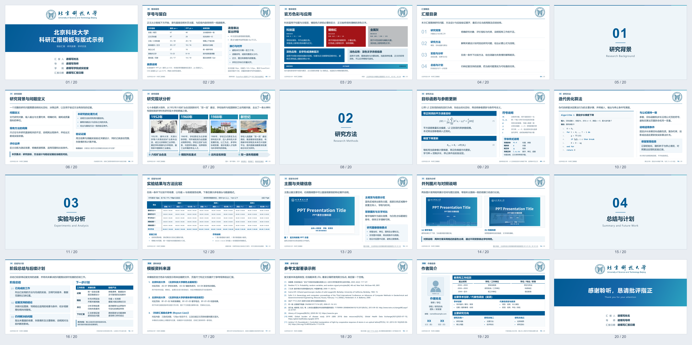

# 北京科技大学科研汇报 HTML 模板

用于组会、研究进展、学术汇报和答辩的本地幻灯片模板。当前包含 20 页版式示例，采用 1600×900 的 16:9 画布，提供四阶段图文研究现状、公式、伪代码、实验表格、图片、总结、参考文献和作者简介等页面。

**分享给别人时，把本目录完整压缩成 ZIP 即可。接收者先解压，再打开 `template.html`。** 不需要部署网站，也不需要安装 PowerPoint。

## 20 页版式预览

按页码从左到右、从上到下排列（5 列 × 4 行）。点击预览图可查看原图；完整内容请打开 `template.html` 或 `template.pdf`。

[](preview.png)


## 快速使用

1. 先复制一份模板用于具体汇报，保留原始母版。
2. 使用 Chrome 或 Edge 打开 `template.html`。
3. 在工具栏选择单列滚动、多页滚动或单页展示；多页视图可选每行 1–6 页。
4. 点击“编辑文字”，修改内容。选中文字后可切换加粗，并选择“恢复原色／科技蓝／钢铁红”。恢复原色保留该位置原本的深色、白色或其他颜色，不统一改成黑色。
5. 点击“检查排版”，再人工查看改过的页面，确认换行、边界、表格和图注合适。
6. 点击“保存HTML”，下载包含修改内容和内嵌图片的独立 HTML。**网页内编辑不会自动写回原文件，关闭前请保存。**

日常改文字可以直接在浏览器完成；增加页面、更换版式和图片、调整公式源代码，适合交给 AI 或使用代码编辑器处理。单页展示支持方向键、空格和 PageUp／PageDown，Esc 返回滚动视图。

第7页“研究现状分析”展示四阶段图文编排：顶部保留页首句，各列依次放年份、统一裁切的图片和两端对齐的说明；底部浅色大箭头承载阶段标题，圆点与文字框左沿对齐，竖线从圆心延伸至上方年份色块顶端，并与其顶端齐平。图片和文字共用浅蓝底；四栏间距16px，箭头两端比内容各多留32px，圆点完整位于箭头内。年份、图片和说明块之间的可见间距统一为16px，段落末行保持左对齐。

### 全屏放映

点击工具栏“全屏放映”，即可隐藏编辑界面并在屏幕内完整展示幻灯片，不依赖 PDF 或打印环境。

- **方向键／空格／PageUp／PageDown：** 翻页；Home／End 跳到首页／末页。
- **鼠标滚轮：** 向下下一页、向上上一页，连续滚动有翻页限频。
- **Ctrl＋滚轮：** 在单页放映中以鼠标位置为中心缩放，范围100%–400%，不改变浏览器页面比例。
- **放大后按住左键拖动：** 移动查看局部细节，拖动范围限制在画布边界内。
- **双击画面：** 进入一行四页的滚动预览；再双击某张缩略页，从该页继续放映。
- **Esc：** 放大时第一次恢复原始大小并清除拖动偏移；恢复后再按一次退出放映。未放大或处于预览时，一次退出，恢复原来的视图与每行页数。

浏览器若不允许原生全屏，会使用窗口放映，翻页及双击预览仍可用。屏幕比例不是 16:9 时保留黑边，保证页面完整。放映状态不会保存到下载的 HTML 中。

翻页、进入四列预览或退出放映时，局部缩放和拖动位置都会重置。保存或打印不会保留临时放大效果。原生全屏下，为实现“两次 Esc”，浏览器可能请求键盘锁权限；若不支持或未允许，第一次 Esc 可能同时退出原生全屏，但仍会恢复原始大小并保留窗口放映，下一次再退出。浏览器的长按 Esc 强制退出功能仍保留。

## 环境要求

| 操作 | 所需环境 |
| --- | --- |
| 查看、演示、编辑文字、保存 HTML | 推荐较新版本的 Chrome 或 Edge；无需 Python、Node.js 或 Office |
| 精确导出 16:9 PDF | Python 3.10+（命令 `python` 可用）和本地 Chrome 或 Edge；无需额外 Python 包 |
| 更换图片后刷新保存用缓存 | Python 3.10+；无需额外 Python 包 |
| 修改 LaTeX 并重绘公式 SVG | Python、可在命令行调用的 `xelatex` 和 `dvisvgm`、Cambria Math 字体，以及 `standalone`、`amsmath`、`unicode-math`、`xcolor` 等 TeX 宏包 |

现有图片、公式和保存用缓存已放在本目录，正常查看、编辑文字及导出 PDF 不需要安装 TeX，也不需要联网加载公式。访问外部文献链接、下载软件或使用在线 AI 服务时才需要相应网络条件。

当前完整操作流程在 Windows + Chrome 下验证过。其他系统可先用浏览器查看；字体替代和浏览器差异可能改变换行，需重新检查。中文字体优先使用微软雅黑，其次为苹方、Noto Sans CJK SC 等系统字体；本包不附带字体安装文件。

## 导出 PDF

**推荐使用配套导出工具，以得到纸张本身就是 16:9 的 PDF。** 不要将内容缩放进 A4 后视为完成。

- 双击 `导出PDF.cmd`：导出磁盘上的 `template.html`。
- 将已保存的其他 HTML 拖到 `导出PDF.cmd` 上：导出该文件，PDF 保存在它的同一目录。
- 浏览器里改过文字时，先“保存HTML”，再导出下载的文件。

也可以在本目录打开终端运行：

```powershell
python scripts/export-pdf.py
python scripts/export-pdf.py "我的汇报.html" --output "我的汇报.pdf"
```

输出每页为 **960×540pt（16:9）**，无浏览器添加的日期、标题和文件路径。工具会检查页数及页面尺寸；默认导出会更新同名 PDF。`template.pdf` 是模板预览快照，HTML 内容改动后需要重新导出。

工具栏“PDF / 打印”提供导出说明和普通浏览器打印入口；普通打印仍受纸张和浏览器设置影响。

## 交给 AI 使用

这是 **HTML 模板包 + AI 排版 skill**，目前没有浏览器扩展或插件安装包。直接把整个目录交给能读写本地文件的 AI，即可按规则加工内容，无须先安装 skill。

可直接这样提出任务：

> 请先读取 web-slide-ustb/SKILL.md，再参照 template.html 和 assets 中的资源，根据我提供的材料制作一份科研汇报。另存为新的 HTML，保留原模板。按实际内容选择页面，不保留无关示例。完成后检查文字换行、图表边界、来源链接及整体排版，并导出 16:9 PDF。

只上传到聊天时，需使用支持文件读取和 HTML 修改的工具；AI 能否执行导出脚本取决于其运行环境。

### 可选：作为 Codex 本地 skill 安装

支持本地 skill 的 Codex 环境可以使用本包。以默认技能目录为例：

1. 将整个文件夹复制到 `~/.codex/skills/beike-ppt-template/`，保留同级的 `template.html`、`assets/` 和 `scripts/`。
2. 确认安装副本的入口名为 `SKILL.md`。分享 ZIP 已使用此名称；若从开发目录复制得到的是 `skill.md`，仅在安装副本中将其改名。不要只复制说明文件。
3. 若设置了 `CODEX_HOME`，安装位置使用 `$CODEX_HOME/skills/beike-ppt-template/`。
4. 安装后在下一轮对话中使用 `$beike-ppt-template`，并提供汇报材料。

Windows 默认路径通常为 `%USERPROFILE%\.codex\skills\beike-ppt-template\`。安装不会自动提供 Python、浏览器或 TeX；仍按上面的操作需求配置。普通浏览器使用者可以跳过整个安装步骤。

## 文件说明与分享方式

| 文件／目录 | 用途 |
| --- | --- |
| `template.html` | 模板入口、页面样式及浏览器交互 |
| `SKILL.md` | 给 AI 的内容组织、排版、检查和交付规则；分享 ZIP 中采用标准入口名 `SKILL.md` |
| `assets/` | 校徽、示例图、头像占位图、数学 SVG 及图片缓存；分享源模板时整体保留 |
| `scripts/` | PDF 导出、图片缓存更新、公式重绘工具 |
| `导出PDF.cmd` | Windows 下的 PDF 导出入口 |
| `template.pdf` | 可直接阅读的静态预览 |
| 两份“北京科技大学…规范.pdf” | 模板配色及视觉规范的参考材料 |
| `新国标参考文献要求.md` | 参考文献著录学习笔记与分类示例 |
| `README.md` | 使用、依赖和分享说明 |

- **分享可继续制作的模板：** 压缩整个目录，保留相对路径。无需包含外层项目、论文原稿、个人实验数据、临时截图或测试文件。
- **分享做好的汇报供演示：** 使用“保存HTML”生成的独立 HTML，可单独发送；图片与公式已内嵌，重新解压后不依赖原目录。接收者仍可使用浏览器交互和文字编辑功能。
- **仅供阅读：** 单独发送导出的 PDF 即可。

《新国标参考文献要求.md》是随包提供的学习笔记，已整理标题、段落和示例排版，不代替国家标准正文。笔记及模板中保留了国家标准信息链接；实际引用仍需核对原文元数据。

本模板为科研汇报用的整理制作成果，不代表学校官方发布。保留学校标识及附带规范材料的原有来源；如以后公开发布项目，可另行明确自行编写代码与文档的许可，第三方素材不自动适用同一许可。

## 维护图片与公式

以下命令均在本目录运行。替换图片后，刷新缓存：

```powershell
python scripts/embed-assets.py
```

修改公式的 `data-tex` 后，先重绘公式，再刷新缓存：

```powershell
python scripts/render-formulas.py
python scripts/embed-assets.py
```

以上脚本也接受目标 HTML 路径。公式以单份 SVG 显示，避免再接入另一套公式渲染器造成重复。换素材后检查页面和保存副本，再重新导出 PDF。


## GitHub 项目目录

本模板位于 `web-slide/web-slide-ustb/`。在本目录运行脚本；不要把仓库外层当作模板根目录。
Windows 可双击 `安装Skill.cmd`，安装为 `$beike-ppt-template`；已存在同名技能时会停止，避免覆盖。其他系统将本目录整体复制到 `~/.codex/skills/beike-ppt-template/`，保留 `SKILL.md` 和所有资源。

返回 [项目总说明](../README.md)。
